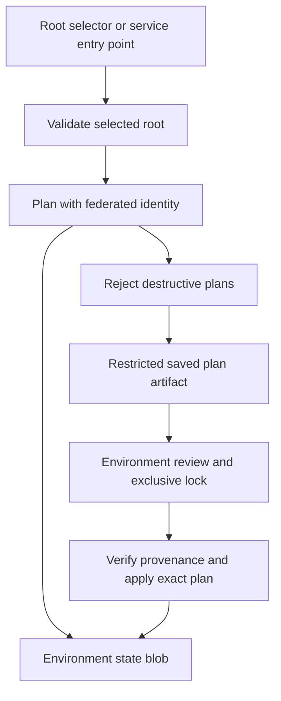

# Azure Automated Pipeline: Compute and Storage

**Author: Dotun Agbeluyi**

Eleven Azure compute and storage services in **one repository**, with a folder per service. Each folder has Terraform modules, Dev and Prod roots, public example inputs, provider lock files, mock tests, an Azure DevOps pipeline entry point and a service README. Common pipeline tooling is shared at the repository root.

This collection is source to keep handy and adapt for specific environments. Services are separate deployment units: selecting one does not deploy all eleven. Publishing the repository does not activate Azure infrastructure deployment. GitHub Actions performs automatic source checks. Both Azure DevOps and GitHub Actions can execute a manual Validate → Plan → Apply deployment after their identity, runner and approval settings are configured. See [GitHub and dual-platform setup](docs/github-actions.md).

## Services

| Service | Folder |
| :--- | :--- |
| [Azure Kubernetes Service](services/aks) | `services/aks` |
| [App Service](services/app-service) | `services/app-service` |
| [Azure Batch](services/batch) | `services/batch` |
| [Azure Container Apps](services/container-apps) | `services/container-apps` |
| [Azure Container Instances](services/container-instances) | `services/container-instances` |
| [Azure Functions](services/functions) | `services/functions` |
| [Azure Storage](services/storage) | `services/storage` |
| [Service Fabric Managed Clusters](services/service-fabric) | `services/service-fabric` |
| [Azure Virtual Desktop](services/virtual-desktop) | `services/virtual-desktop` |
| [Virtual Machines](services/virtual-machines) | `services/virtual-machines` |
| [Virtual Machine Scale Sets](services/vm-scale-sets) | `services/vm-scale-sets` |

These are ten selected compute services plus Azure Storage, not an official popularity ranking. Virtual Machines contains the earlier reconstructed Windows Server/Bastion implementation; the other folders are newly authored infrastructure references. The collection is not an export of the original local InfraProject repository. The separate [azure-aks-platform](https://github.com/dotman01k/azure-aks-platform) repository retains its own completed deployment evidence; it is not evidence that these new references were deployed.

## How to use it

1. Choose a service folder and read its README, costs and prerequisites.
2. Edit that folder's `environments/dev/terraform.tfvars.json`; replace every synthetic subscription, group, CIDR, public key or certificate value relevant to the service.
3. Complete [shared setup](docs/setup.md): existing RG/backend, federated Azure service connection, Windows agent, variable group and approval environment.
4. Create an Azure DevOps pipeline using the service's `azure-pipelines.yml`, or use the root pipeline and select its `service` parameter.
5. Run `operation=plan` first. For deployment, start a new `operation=apply` run and approve **that run's** saved plan.
6. Execute the service-specific application publish/host registration steps where documented. Infrastructure completion alone is not runtime acceptance.

## Choose a deployment platform

Use Azure DevOps with its existing root or service pipeline, or use GitHub Actions → Deploy Azure service. Both share Terraform code, backend keys and policy checks. GitHub deployment stays disabled until `GH_DEPLOY_ENABLED=true` and the protected environments are configured. It encrypts saved plan artifacts for this public repository. Follow [GitHub setup and plan review](docs/github-actions.md); keep one active platform run per service/environment.

The root `azure-pipelines.yml` contains the full Azure DevOps flow and literal `terraform fmt`, `init`, `validate`, `plan` and `apply` commands directly; there is no separate shared stage template. Each service pipeline also contains the full stages, with its service selection fixed. CI compares their stages and variables with the root pipeline to prevent deployment logic from drifting. The Prepare helper sets authentication, secret inputs and the state key; RecordPlan/VerifyPlan enforce policy and saved-plan provenance. Azure YAML runs the actual Terraform CLI commands between those helpers.

## Shared pipeline behavior

The normal pipeline rejects deletions, replacements, forget actions and incomplete/deferred plans. It permits reviewed creates and in-place updates. A no-destruction gate is not a no-change guarantee. Apply verifies the selected service, environment, build, commit, backend and saved plan hash. External Azure DevOps approvals, branch controls and exclusive locks must be configured by a resource administrator; YAML does not create them automatically.

All Terraform data sources live in a separate `data.tf` within the module or environment that uses them. `main.tf` holds managed resources, module calls and outputs. Modules with no data sources do not need an empty data file.

### Paths and boundaries

| Path | Responsibility |
| :--- | :--- |
| `services/<service>/modules` | Service-specific Azure resources |
| `services/<service>/environments/dev` | Independent Dev root |
| `services/<service>/environments/prod` | Independent Prod root |
| `services/<service>/azure-pipelines.yml` | Standalone full pipeline fixed to this service |
| `services/<service>/project.json` | Service identity, allowed secret names and provider registrations |
| `azure-pipelines.yml` | Complete Azure DevOps parameters, variables, Validate, Plan and Apply stages |
| `scripts` | Pinned Terraform install, federated auth, input checks, plan policy and provenance |
| `tests` | Shared policy, input, collection and application tests |
| `.github/workflows/deploy.yml` | Manual GitHub deployment with protected environments and encrypted plans |
| `.github/workflows/validate.yml` | Credential-free matrix validation across all eleven services |

New state keys are `compute/<service>/<environment>.tfstate`. The moved Virtual Machines project preserves its existing `windows-vm-dev.tfstate` and `windows-vm-prod.tfstate` keys and `module.windows_vm` resource addresses. See [migration notes](docs/migration.md) before updating an already configured pipeline.

## Security and identity

Azure DevOps uses workload identity federation through `AzureCLI@2`; GitHub Actions uses its own federated Entra trust. Each runtime refreshes its own assertions, and saved plans are bound to that platform and run. Bootstrap RGs, provider registrations, state containers and Azure DevOps permissions remain operator setup tasks. Contributor over the selected service RG plus Blob Data Contributor on its backend are the baseline. Services assigning RBAC also need scoped role assignment authority; see each README.

Shared storage accounts/containers do not enforce access isolation between state keys. Use distinct containers/accounts and service connections where an environment must not read another state. Administrator passwords are mapped only from the secret variable `TF_SECRET_JSON`; no live password belongs in the JSON tfvars. AVD registration tokens and Service Fabric client private certificates are kept out of Terraform inputs/state by this design.

The privacy boundary varies by service: some use private endpoints or VNet addresses, some use public CIDR restrictions, and Service Fabric has authenticated management endpoints. Read the selected folder rather than assuming one network model applies everywhere.

## Validation and scope

Terraform 1.13.0 and AzureRM 4.68.0 are pinned. Hosted CI validates 22 environment roots and eleven modules, exercises PowerShell validation for both roots, runs the module mock tests and the shared Python suite. [Validation notes](docs/validation.md) link the recorded checks and explain what remains live acceptance.

Mock plans and offline tests check configuration and script behavior. They do not prove subscription quota, regional SKU availability, Azure DevOps server expansion, real authentication, image pull, guest extension behavior, application publishing, AVD login or Service Fabric recovery. Each folder documents its implemented scope and remaining acceptance checks. Production roots provide separate configuration/state; the word Prod does not establish HA or production approval.

For the original Windows project's historical troubleshooting, see [earlier lessons](docs/lessons.md). No deployment outcome from that earlier project is assigned to the new service folders.

## Costs and retirement

All live examples can incur Azure charges. A zero node Batch pool and scale-to-zero Container App may still have networking, DNS, storage or monitoring charges. App Service plans, Bastion, NAT Gateways and Service Fabric nodes have continuing costs. Review service-specific costs before applying.

There is no normal destroy operation. Retirement needs an explicitly reviewed maintenance change, correct service/environment/backend, data retention decisions and reconciliation of Azure inventory with Terraform ownership. Windows VM, AVD host and Service Fabric lifecycle protection must be deliberately handled. Bootstrap resources and Azure DevOps identities/registrations need separate cleanup; shared backend storage must outlive all dependent deployments. See [operations](docs/operations.md).
