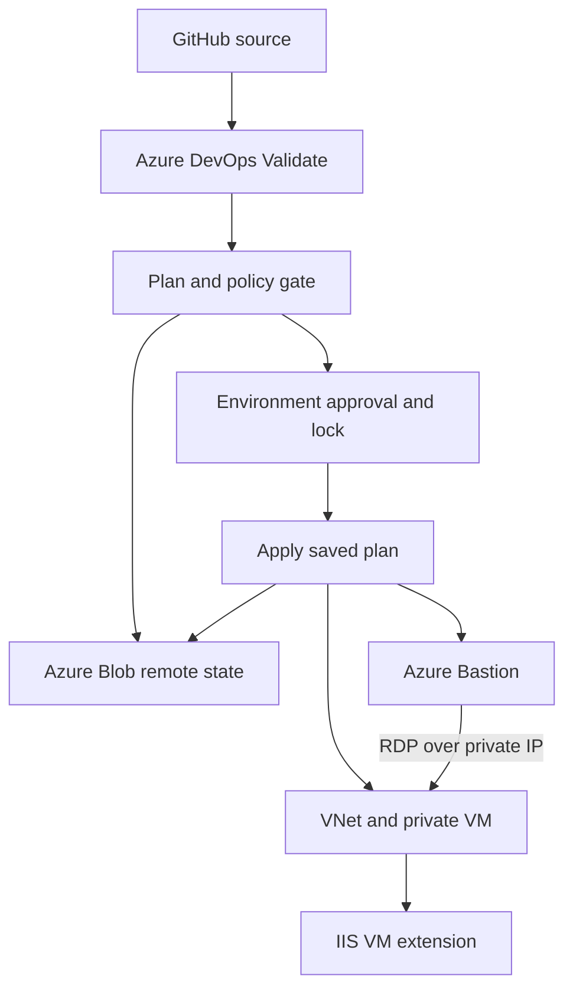

# Azure Automated Pipeline

[](https://github.com/dotman01k/azure-automated-pipeline/actions/workflows/validate.yml)

**Author: Dotun Agbeluyi**

Terraform infrastructure and an Azure DevOps pipeline for a Windows Server 2025 VM with private network access through Azure Bastion. The pipeline separates validation, planning and application, stores Terraform state in Azure Blob Storage, uses federated Azure authentication and applies the reviewed saved plan from the same pipeline run.

**Source provenance:** this is a fresh reconstruction of the earlier Infra Project design. The original files on the author's Windows machine were not available during preparation. This repository does not claim to be an export of that repository or to reproduce its exact deployed state. The YAML is intended to execute in Azure DevOps; GitHub hosts the source and runs independent source validation.

The original design informed the Windows agent model, reusable `modules/windows-vm` module, `environments/dev` layout, remote state and pipeline stages. Known problems from that earlier work are recorded below as historical lessons, separate from this implementation's validation evidence.

## Architecture



The workload NIC has no public IP. A workload NSG allows RDP from the Bastion subnet, HTTP from the VNet and denies other inbound traffic. The only public IP belongs to Bastion. Basic Bastion uses the dedicated `AzureBastionSubnet`; no NSG is attached to that subnet in this implementation. Its own service connectivity must remain available.

The Windows VM uses Trusted Launch settings, managed boot diagnostics, a system assigned identity, automatic platform patching and a configurable OS disk. A Custom Script Extension optionally installs IIS, writes a small landing page, starts the service and checks HTTP locally. There is no public application listener, WinRM setup or separate application delivery repository in this scope.

## Repository contents

| Path | Purpose |
| :--- | :--- |
| [azure-pipelines.yml](azure-pipelines.yml) | Manual Validate, Plan and Apply stages for a Windows agent |
| [modules/windows-vm](modules/windows-vm) | Network, NSG, private NIC, VM, Bastion and optional IIS configuration |
| [environments/dev](environments/dev) | Development root and public configuration contract |
| [environments/prod](environments/prod) | Separate production root and state key |
| [scripts/Install-Terraform.ps1](scripts/Install-Terraform.ps1) | Pinned CLI download with vendor checksum comparison |
| [scripts/Invoke-Terraform.ps1](scripts/Invoke-Terraform.ps1) | Init, validate, saved plan provenance, plan gate and exact plan apply |
| [scripts/validate_inputs.py](scripts/validate_inputs.py) | Subnet, input and live placeholder checks |
| [scripts/plan_policy.py](scripts/plan_policy.py) | Reject deletion, replacement, incomplete plans and unsupported actions |
| [tests](tests) | Input/policy tests and PowerShell syntax verification |
| [.github/workflows/validate.yml](.github/workflows/validate.yml) | Source validation without Azure deployment credentials |
| [docs/operations.md](docs/operations.md) | Verification, troubleshooting, imports and cleanup |

## Infrastructure contract

| Setting | Development example | Production example |
| :--- | :--- | :--- |
| Root | `environments/dev` | `environments/prod` |
| Resource group, created before Terraform | `rg-platform-vm-dev-eastus` | `rg-platform-vm-prod-eastus` |
| State key, fixed by the pipeline | `windows-vm-dev.tfstate` | `windows-vm-prod.tfstate` |
| VNet | `10.30.0.0/16` | `10.31.0.0/16` |
| Workload subnet | `10.30.1.0/24` | `10.31.1.0/24` |
| Bastion subnet | `10.30.0.0/26` | `10.31.0.0/26` |
| Windows computer name | `windev01` | `winprod01` |
| VM size example | `Standard_D2s_v3` | `Standard_D2s_v3` |
| OS image | Windows Server 2025 Datacenter Azure Edition | Same |
| OS disk | 128 GiB Standard SSD | Same |

These sizes are examples, not capacity commitments. Both profiles contain one VM and one Bastion; the production root provides state and configuration isolation, not application HA. Validate SKU capacity, image/Trusted Launch compatibility, patching support and vCPU quota for the actual subscription. Keep the Dev and Prod service connections and variable groups separate.

## Prerequisites

1. Terraform 1.13.0 and AzureRM 4.68.0. Dependency lock files are committed. Provider registration is disabled in the provider configuration and must be completed during bootstrap.
2. A trusted Windows x64 Azure DevOps agent, with PowerShell 7 (`pwsh`), Git, Azure CLI and Python 3 available to its service account. The default pool name is `InfraProject`; override the pipeline parameter if yours differs.
3. A private Azure DevOps project with restricted pipeline artifact access. Saved Terraform plans may contain the administrator password even when plan text redacts it. Do not use a public Azure DevOps project for live runs.
4. An Azure Resource Manager service connection using **workload identity federation**. Use the exact issuer and subject supplied by the Azure DevOps service connection flow; do not reuse GitHub's OIDC issuer or subject.
5. Dedicated project resource groups and an existing Blob state backend accessible from the agent. Enable state versioning and soft delete before live deployment.
6. A complex Windows administrator password, 16 through 72 characters, held only as an Azure DevOps secret variable. Windows/Azure complexity and username rules still apply.

## Exact setup

### 1. Clone and review the reconstruction

```bash
git clone https://github.com/dotman01k/azure-automated-pipeline.git
cd azure-automated-pipeline
```

Review the module, pipeline, examples and import guidance. When the original local InfraProject source becomes available, compare it with this implementation before migrating any real state. Do not point this code at an existing environment just because the names look familiar.

### 2. Bootstrap resource groups and state

From an authorized Azure CLI session, choose the subscription and a globally unique state account. The example uses commercial Azure and East US:

```bash
az account set --subscription '<subscription-id>'
az provider register --namespace Microsoft.Compute --wait
az provider register --namespace Microsoft.Network --wait
az provider register --namespace Microsoft.Storage --wait
az provider register --namespace Microsoft.ManagedIdentity --wait

az group create --name rg-platform-state --location eastus
az group create --name rg-platform-vm-dev-eastus --location eastus
az group create --name rg-platform-vm-prod-eastus --location eastus

az storage account create \
  --resource-group rg-platform-state \
  --name '<unique-state-account>' \
  --location eastus --sku Standard_LRS --kind StorageV2 \
  --min-tls-version TLS1_2 \
  --allow-blob-public-access false \
  --allow-shared-key-access false
```

Assign the bootstrap operator Storage Blob Data Contributor on this account before creating the private container with `az storage container create --account-name '<unique-state-account>' --name tfstate --auth-mode login`. Configure blob versioning and soft delete with your retention requirements. Allow time for RBAC propagation. The backend public endpoint is secured with Entra authorization; private endpoint/firewall deployment needs an agent connectivity design beyond this baseline.

The workload groups and state account are bootstrap resources outside this Terraform state. The pipeline reads the workload RG instead of granting itself subscription wide permissions to create groups.

### 3. Configure Azure DevOps identity and authorization

In Azure DevOps, create service connections such as `sc-platform-dev` and `sc-platform-prod` using Azure Resource Manager workload identity federation. Limit pipeline permission to this pipeline rather than granting every pipeline access.

Grant each deployment identity:

| Scope | Required role or capability |
| :--- | :--- |
| Its own workload RG | Contributor for VM, network, managed identity, Bastion and extension operations |
| State container/account | Storage Blob Data Contributor for state read/write and blob leases |
| State RG/account management metadata | Reader if required for backend account discovery |

Contributor is not a data-plane storage role. The service connection does not need Owner, User Access Administrator or directory administrator for normal deployments. Group creation and provider registration use separate operator privileges. For stronger isolation, use a separate backend account/container per environment; distinct keys within one shared container do not restrict an identity to only one state blob.

### 4. Edit the public environment inputs

Replace the synthetic subscription ID in `environments/dev/terraform.tfvars.json` and the corresponding Prod file. Review resource group, location, VM size, computer name, disk size, CIDRs and `install_iis`.

The input checker refuses live deployment with the supplied synthetic subscription. It also rejects passwords in this JSON, overlapping/outside subnets and a Bastion subnet smaller than /26. Keep sensitive values out of commits and pull requests.

Do not put live credentials into `backend.hcl.example`. Live pipeline initialization assembles backend settings from the variable group and selects its fixed environment state key. The example backend file documents the equivalent configuration.

### 5. Create variable groups

Create `windows-vm-dev` and `windows-vm-prod` under Pipelines → Library. Authorize only the intended pipeline.

| Variable | Example or purpose |
| :--- | :--- |
| `STATE_RESOURCE_GROUP` | `rg-platform-state` |
| `STATE_STORAGE_ACCOUNT` | Actual backend account name |
| `STATE_CONTAINER` | `tfstate` |
| `VM_ADMIN_PASSWORD` | Secret variable; never commit its value |

Subscription and identity values come from the federated service connection. The script checks that its authenticated subscription matches the selected Terraform inputs. The WIF token is taken from `AzureCLI@2` with `addSpnToEnvironment: true`; client secrets and storage keys are not used.

### 6. Configure environment approvals and locks

Create deployment environments `windows-vm-dev` and `windows-vm-prod`. In each environment's **Approvals and checks**, configure required reviewers, branch control for `main` and an exclusive lock. These controls are Azure DevOps settings, not automatically created by YAML. `lockBehavior: sequential` only controls an existing lock check.

A named environment alone does not enforce approval. Review changes before authorizing service connections/variable groups and restrict who can edit the deployment branch. The normal pipeline rejects destructive plan actions, but trusted administrators can still change the pipeline and policies.

### 7. Create and run the Azure pipeline

Create a pipeline using GitHub as the source and select `azure-pipelines.yml`. Authorize the repository connection and agent pool. Manual triggers are intentional; pushes and PRs do not start live Azure runs.

First run with:

| Parameter | Dev value |
| :--- | :--- |
| environment | `dev` |
| operation | `plan` |
| agentPool | Your Windows agent pool, default `InfraProject` |
| serviceConnection | Actual Dev WIF connection, default `sc-platform-dev` |

Validate runs formatting, backend-free initialization, provider schema checks, input validation and offline policy tests. Plan authenticates through WIF, initializes the remote backend and saves `platform.tfplan`, a redacted review rendering and a provenance manifest as a restricted pipeline artifact.

For deployment, start a new run with `operation=apply`. That run makes a **new plan**. Inspect its `approved-plan/plan.txt` artifact before approving the Apply environment. Apply downloads the current run's binary plan and checks environment, source commit, build ID, Terraform version, backend identity and SHA256 before applying that exact binary. It does not replan in Apply.

The manifest is an integrity/provenance check within the trusted pipeline, not an independently signed attestation. Retain pipeline runs/artifacts only as long as necessary; keep their access restricted. A stale saved plan fails rather than being silently replaced with a fresh plan.

## Validation and deployment evidence

The repository includes 18 offline Python tests and four Terraform mock plan tests, plus provider validation for both roots and the module. PowerShell files are parsed in GitHub CI. See the [validation workflow](https://github.com/dotman01k/azure-automated-pipeline/actions/workflows/validate.yml) and [validation notes](docs/validation.md) for results and boundaries.

A hosted source check does not execute an Azure DevOps service connection, environment approval or Azure VM deployment. Azure DevOps YAML server expansion, live WIF/Blob permissions, regional capacity, Bastion login, VM extension success and actual platform patching require a separately authorized live run. Historical outcomes from the earlier Infra Project are not used as validation claims for this reconstruction.

## Earlier project blockers and lessons

| Earlier blocker | Lesson carried into this implementation |
| :--- | :--- |
| Terraform init reported too many arguments | Pass native arguments as a PowerShell array and check every native exit code. |
| Provider configuration lacked `features {}` | Include explicit AzureRM configuration in each environment root. |
| Blob storage returned AuthorizationPermissionMismatch | Assign Blob Data Contributor; Contributor alone does not grant state data access. |
| A local session held the state lease | Respect state locking and serialize approved applies; never force-unlock an active operator. |
| East US DSv5 quota was zero | Make VM size explicit and verify the chosen family's quota rather than assuming a size is available. |
| Existing NIC conflicted with Terraform creation | Reconcile real inventory and declarative imports before applying a fresh configuration. |
| Subnet lookup failed | Keep subnet creation and references inside one module dependency graph. |
| A Windows update property was deprecated | Use the pinned provider's `automatic_updates_enabled` property and validate its schema. |
| CRLF warnings made reviews noisy | Commit text normalization rules and use PowerShell Core for predictable script behavior. |

These describe earlier troubleshooting context. They are not claims that this newly published pipeline encountered or fixed those errors in Azure.

## Costs and teardown

Publishing source does not activate the Azure pipeline. Live apply creates billable Windows VM compute, its managed disk, Basic Bastion and a Standard public IP; backend storage and transactions also have costs. Bastion continues to cost money even when the VM is stopped. This is not an always free lab. Calculate current region/offer costs before apply.

The normal plan policy rejects deletes/replacements and the VM uses `prevent_destroy`. Retirement is an explicit maintenance change: preserve required data, review the correct environment/backend, remove lifecycle protection only in a reviewed teardown branch and use an approved Terraform destroy process outside this normal pipeline. Remove the IIS extension/VM and dependent NIC before networking, then Bastion and its public IP/subnet. Retain state until Azure inventory and Terraform ownership agree.

Bootstrap workload RGs, state storage, role assignments, Azure DevOps variable groups, agent registration and service connections require separate cleanup. Delete a state account only after proving no other project/environment still uses it. Do not delete state as a workaround for drift or a duplicate NIC.

## Limitations

This scope is one Windows VM per environment, private administrative access and optional IIS configuration. It does not include domain join, an application database, certificates, a public web endpoint, HA, backup, disaster recovery, organizational compliance assignments or a full application release pipeline. System identity is created but has no broad application roles assigned. Browser access to IIS through the Windows desktop requires an authorized Bastion login and the VM credentials.

The default Windows image is selected with version `latest`; source validation cannot guarantee future image behavior. For controlled production rollouts, resolve and pin an approved image version. The basic password checks do not replace Windows complexity requirements. State, plan artifacts and trusted agent disks must be treated as sensitive.

## Official references

1. [AzureCLI task and federated identity variables](https://learn.microsoft.com/azure/devops/pipelines/tasks/reference/azure-cli-v2?view=azure-pipelines)
2. [Azure DevOps approvals and checks](https://learn.microsoft.com/azure/devops/pipelines/process/approvals?view=azure-devops)
3. [AzureRM Windows VM, pinned provider](https://registry.terraform.io/providers/hashicorp/azurerm/4.68.0/docs/resources/windows_virtual_machine)
4. [Azure Bastion networking](https://learn.microsoft.com/azure/bastion/bastion-nsg)
5. [Terraform AzureRM backend](https://developer.hashicorp.com/terraform/language/backend/azurerm)
6. [Terraform mock provider tests](https://developer.hashicorp.com/terraform/language/tests/mocking)
