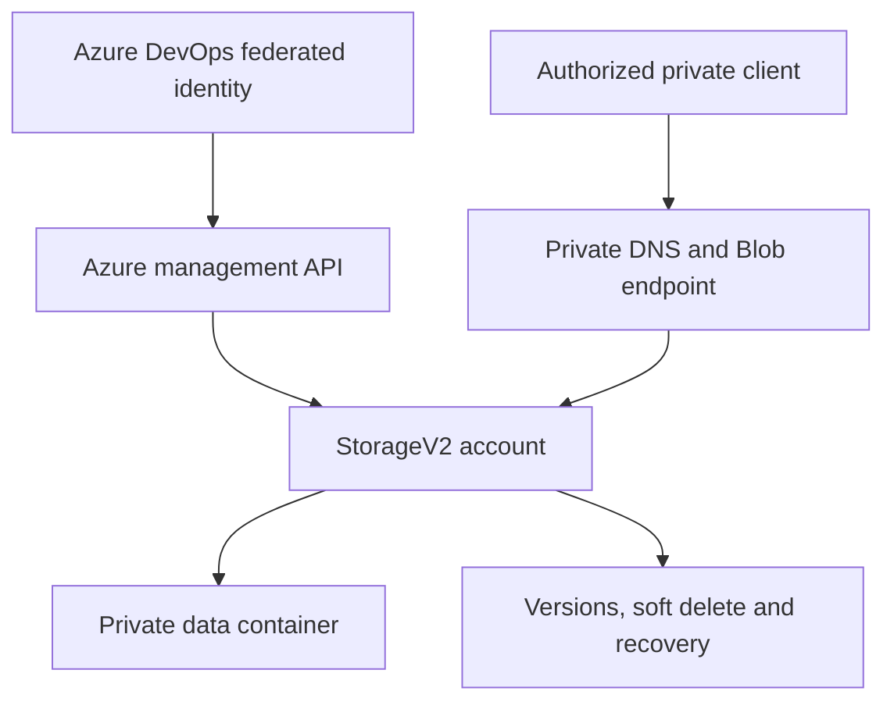

# Azure Storage: private Blob platform

A dedicated StorageV2 account with private Blob connectivity, Entra authorization, retained versions, soft delete, point in time recovery and lifecycle tiering. This is the Storage folder in [Azure Automated Pipeline](../../README.md); it uses the same protected Azure DevOps pipeline as the compute folders.

## Architecture



Public network access, anonymous containers and shared key authorization are disabled. The account uses HTTPS, TLS 1.2 and infrastructure encryption with Microsoft managed keys. This reference configures **Blob** storage. Queue, Table, Azure Files, HNS/Data Lake, geo failover and customer managed keys are separate designs, not included here.

The module reads an **existing VNet and dedicated endpoint subnet**, creates a private Blob endpoint, creates `privatelink.blob.core.windows.net`, and links it to that VNet. An agent/client needs routing and correct DNS to this network. It does not create a VPN, agent, VNet, peering or DNS resolver. Use a dedicated network without an existing conflicting Blob private DNS zone link. In a shared enterprise DNS deployment, adapt the zone resources to use centrally managed DNS before applying.

## Files and configuration

| Path | Purpose |
| :--- | :--- |
| `modules/compute` | Storage, private endpoint, DNS, lifecycle and scoped data role |
| `environments/dev` | Independent LRS example root |
| `environments/prod` | Independent ZRS example root |
| `azure-pipelines.yml` | Storage-specific pipeline entry point |
| `project.json` | Provider and secret contract |

The module directory keeps the collection's shared `compute` convention. The selected service slug is `storage`.

| Setting | Dev example |
| :--- | :--- |
| Workload RG | `rg-storage-dev` |
| Existing network RG | `rg-network-dev` |
| Existing VNet | `vnet-private-dev` |
| Existing subnet | `private-endpoints` |
| Variable group and deployment environment | `compute-storage-dev` |
| State key | `compute/storage/dev.tfstate` |
| Required secret JSON | `{}` |

## Prerequisites and exact deployment sequence

1. Follow [shared setup](../../docs/setup.md) for the existing workload RG, private state backend, Windows agent, refreshable Azure DevOps workload federation and protected environment. Register `Microsoft.Storage` and `Microsoft.Network` in the selected subscription.
2. Provide an existing IPv4 VNet and dedicated subnet in the deployment region. Reserve free endpoint addresses and review subnet NSG, private endpoint policy and routing settings. Connect the agent and a validation client privately. If they use custom DNS, configure forwarding to resolve Azure Private DNS; creating a zone link alone does not configure a custom DNS server.
3. Edit `environments/dev/terraform.tfvars.json`: replace the synthetic subscription, network names and `data_principal_id`. This must be the **object ID** of an actual Entra user, group, service principal or managed identity. Do not use its application/client ID. Choose your storage prefix and region. A deterministic suffix is added, but Azure must still accept the globally unique name.
4. Create variable group `compute-storage-dev` with `AZURE_SERVICE_CONNECTION_ID`, `STATE_RESOURCE_GROUP`, `STATE_STORAGE_ACCOUNT`, `STATE_CONTAINER` and `TF_SECRET_JSON={}`. The connection GUID must match the selected named service connection. The workload account is **not** the Terraform backend account.
5. Configure approvals, main branch checks and the exclusive lock on environment `compute-storage-dev`. Authorize only the intended pipeline to use these protected resources.
6. Create an Azure DevOps pipeline using `services/storage/azure-pipelines.yml`, or select `storage` in the root pipeline. Select `dev`, your Windows pool, your federated service connection and `operation=plan`.
7. Review the account configuration, role recipient, existing network selection and private DNS changes. Start `operation=apply`, inspect **that run's** saved plan and approve it. Apply verifies provenance and applies that exact binary plan. Prod uses separate state and must be reviewed independently; confirm ZRS availability in its region.
8. Complete private connectivity, data authorization and recovery acceptance below. Offline validation does not establish these outcomes.

## Identity and RBAC

The deployment identity needs Contributor on the workload RG, scoped role assignment authority there, and Storage Blob Data Contributor on the **backend** independently. On the existing network it needs sufficient read permissions and private endpoint subnet join permission; scoped Network Contributor on the selected subnet plus Reader on its VNet/RG is a practical baseline to review. Contributor on the workload RG alone does not grant cross-RG network access.

The configured data principal receives Storage Blob Data Contributor on this dedicated workload account. Management Contributor alone does not authorize blob reads. No storage key, connection string or client secret is returned in the module outputs. Container creation uses `storage_account_id`, which the pinned AzureRM provider sends through the management API. Normal data operations must use Entra authorization and the private endpoint. Both roots set `features.storage.data_plane_available=false` for the pinned provider. This prevents the storage account create/read path from waiting on public data endpoints before its dependent private endpoint exists. This reference manages account properties, containers and lifecycle through ARM; queue/static website data-plane properties are not configured. Preserve this feature setting when reusing the module. Blob I/O acceptance still requires the privately connected client.

## Access verification

Use a privately connected shell signed in as a principal covered by the assigned data role. For a group assignment, ensure the login session reflects current group membership and allow RBAC propagation. Read `contract.account_name` from the successful Terraform outputs, then run:

```bash
STORAGE_ACCOUNT='<actual contract.account_name>'
nslookup "${STORAGE_ACCOUNT}.blob.core.windows.net"
printf 'private blob validation\n' > storage-check.txt
az storage blob upload --account-name "$STORAGE_ACCOUNT" \
  --container-name data --name acceptance/storage-check.txt \
  --file storage-check.txt --auth-mode login --overwrite true
az storage blob download --account-name "$STORAGE_ACCOUNT" \
  --container-name data --name acceptance/storage-check.txt \
  --file storage-check-downloaded.txt --auth-mode login --overwrite true
cmp storage-check.txt storage-check-downloaded.txt
az storage blob list --account-name "$STORAGE_ACCOUNT" \
  --container-name data --prefix acceptance/ --include v --auth-mode login -o table
```

DNS should resolve the normal account hostname through its private alias to a subnet IP. Use the normal Blob hostname, not a hard-coded endpoint IP. From a client without a private route, an authenticated blob operation should fail. Also verify shared key authentication is disabled and anonymous access fails. An outside client's DNS resolution alone does not prove access is possible.

## Recovery and operations

Blob versions and change feed are enabled, with 30-day change feed retention, 30-day blob soft delete, 14-day container soft delete and a seven-day point in time restore policy. Point in time restore applies to supported block blobs; it does not recover an accidentally deleted storage account, replace container restore procedures, or provide independent regional backup. LRS and ZRS both remain within one region.

In a disposable acceptance prefix, upload version A, overwrite with B, list retained version IDs and restore A into a separate blob using an authorized Entra client. Compare contents. Separately test soft delete/undelete. Record timestamps and checksums, not tokens or sensitive data. Exercise an account restore only in an isolated recovery drill: select the exact UTC restore time and blob range, obtain required restore permissions, review overwrite impact, submit through Azure's Blob restore operation and monitor its completion. A restore policy being configured is not evidence of a successful recovery. See [Microsoft point in time restore guidance](https://learn.microsoft.com/azure/storage/blobs/point-in-time-restore-overview).

The lifecycle policy moves block blobs under `data/` to Cool after 30 days without modification. It does **not** permanently delete blobs, snapshots or versions. Retained versions can grow without bound until an operator introduces a separately reviewed retention policy. Monitor capacity, transaction counts, error rates and private endpoint connection state; this module does not provision a log workspace, diagnostic export or alerts. Apply the organization's observability policy separately.

## Costs

Charges can include stored current/previous versions, soft-deleted data, change feed, transactions, Cool retrieval and early deletion, replication, private endpoint hours/data processing and private DNS. ZRS differs from LRS pricing and is not a cross-region backup. A quiet account and a private endpoint can still incur costs. Check current regional [Storage pricing](https://azure.microsoft.com/pricing/details/storage/blobs/) before deployment. No live Azure deployment is performed by this repository's GitHub validation workflow.

## Troubleshooting

| Symptom | Check |
| :--- | :--- |
| DNS returns a public address | VNet zone link, custom DNS forwarding and client resolver |
| Private address resolves but requests time out | Route, VPN/peering, endpoint approval, NSG and subnet settings |
| AuthorizationPermissionMismatch | Data principal object ID, Blob data role, token freshness and RBAC propagation |
| KeyBasedAuthenticationNotPermitted | Use `--auth-mode login`; do not enable shared keys |
| Private endpoint join denied | Cross-RG subnet permission for the deployment identity |
| DNS link conflicts | Existing central zone ownership; adapt to shared DNS rather than creating overlapping zones |
| Provider refresh denied | Preserve the storage data_plane_available=false feature, check management API permission and the pinned provider version |
| ZRS unavailable | Region and storage SKU support; review an intentional replication change |
| Replacement/deletion rejected | Shared plan policy and lifecycle guards; review maintenance and ownership first |

## Cleanup and limitations

Inventory live blobs, versions and retained/deleted data before retirement. Preserve required recovery copies and reconcile Terraform ownership. Storage account and container `prevent_destroy` guards must be deliberately removed in a reviewed maintenance change; the normal pipeline separately rejects destroy/replacement actions. Use an explicitly authorized maintenance procedure against `compute/storage/<environment>.tfstate`, remove endpoint/DNS/role dependencies in the planned order, and inspect Azure inventory afterwards. The existing VNet/subnet and shared backend are not owned by this module and must remain. Follow [shared retirement guidance](../../docs/operations.md).

This is a private Blob infrastructure baseline. It does not supply centralized DNS integration, application identities, independent backup, immutable retention, automatic data deletion, failover orchestration or proof of successful recovery.

## Validation

Four credential-free Terraform mock runs check private/Entra boundaries, recovery prerequisites and invalid inputs. CI also validates both environment roots, PowerShell entry points and shared policy/input tests. [Recorded validation](../../docs/validation.md) distinguishes source checks from live acceptance. Real DNS, role propagation, blob I/O and recovery drills require an authorized Azure deployment.

## API references

1. [Pinned AzureRM Storage account](https://registry.terraform.io/providers/hashicorp/azurerm/4.68.0/docs/resources/storage_account)
2. [Pinned container management API behavior](https://registry.terraform.io/providers/hashicorp/azurerm/4.68.0/docs/resources/storage_container)
3. [Private endpoints for Azure Storage](https://learn.microsoft.com/azure/storage/common/storage-private-endpoints)
4. [Blob point in time restore](https://learn.microsoft.com/azure/storage/blobs/point-in-time-restore-overview)
5. [Blob lifecycle management](https://learn.microsoft.com/azure/storage/blobs/lifecycle-management-overview)

## GitHub Actions alternative

This service can also deploy through the shared GitHub Actions workflow. Follow [GitHub setup](../../docs/github-actions.md), select this folder's service name and use the same backend key. Configure GitHub's separate Plan/Apply environments and approvals before enabling deployment. The Azure DevOps entry point remains available.
